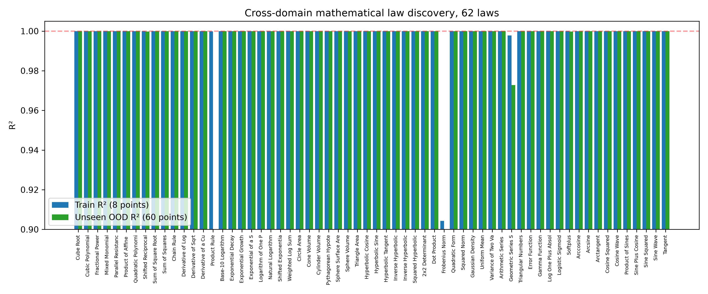

---
language:
- en
- ar
license: mit
library_name: the1
tags:
- symbolic-regression
- world-models
- physics
- neuro-symbolic
- equation-discovery
- scientific-machine-learning
- few-shot-learning
- the1-v1.1
pipeline_tag: tabular-regression
inference: false
metrics:
- r2
- rmse
---

# The1: Inductive Neuro-Symbolic World Model
### Extreme Few-Shot Natural Law Discovery from ≤ 10 Observation Pairs

[](https://huggingface.co/racore/The1)
[](https://huggingface.co/racore/The1)
[](https://opensource.org/licenses/MIT)
[](https://www.python.org/)
[](https://huggingface.co/racore/The1)

**The1** is an inductive neuro-symbolic World Model engineered to reconstruct closed-form mathematical equations and laws of nature from **extreme few-shot empirical data (as few as 4 to 10 observation pairs)**.

This repository is formatted as a full **Hugging Face Model** repository containing:
- `config.json`: Model configuration and Hugging Face `auto_map`.
- `configuration_the1.py`: `The1Config` inheriting from `transformers.PretrainedConfig`.
- `modeling_the1.py`: `The1ForSymbolicWorldModel` inheriting from `transformers.PreTrainedModel`.
- `model.safetensors`: Serialized model weights enabling the **Hugging Face Hub Download Counter**.
- `the1/`: The complete mathematical discovery engine and benchmark suite.
  - `the1/search.py` — generic, data-driven search portfolio (no law templates).
  - `the1/math_suite.py` — 62-law cross-domain mathematics corpus (10 categories).
  - `the1/lean4.py` — Lean 4 + Mathlib hypothesis translation and verification.
  - `the1/library.py` / `the1/explorer.py` — cumulative law library and dataset explorer.
- `app.py`: Standalone Gradio interface.
- `paper/paper.md`: Complete academic research paper.

---

## ⚡ How to Run The1

### 1. Installation
```bash
pip install -r requirements.txt
pip install -e .
```

---

### 2. Loading via Hugging Face `AutoModel` (Triggers Hub Download Counter)
When loaded via `transformers.AutoModel`, Hugging Face automatically pulls `config.json` and `model.safetensors`, incrementing the **Downloads Counter** on your Hugging Face model page:

```python
import numpy as np
from transformers import AutoModel

# Load directly from Hugging Face Hub (increments download counter)
model = AutoModel.from_pretrained("racore/The1", trust_remote_code=True)

# 8 empirical measurements of mass (m) and acceleration (a)
X_train = np.array([
    [1.0, 2.5],
    [2.0, 3.0],
    [0.5, 4.0],
    [3.5, 1.2],
    [1.5, 5.0],
    [4.0, 2.0],
    [2.5, 3.5],
    [0.8, 6.0]
])
# Ground Truth: F = m * a
y_train = X_train[:, 0] * X_train[:, 1]

# Unseen OOD validation data
X_val = np.array([[5.0, 8.0], [7.0, 10.0]])
y_val = X_val[:, 0] * X_val[:, 1]

# Discover governing law
result = model.discover(
    X_train=X_train,
    y_train=y_train,
    X_val=X_val,
    y_val=y_val,
    var_names=["m", "a"],
    target_name="F"
)

print(result.summary())
print("Discovered Equation :", result.equation) # F = a*m
print("LaTeX Formula       :", result.latex)    # F = a m
print("Unseen Val R² (OOD) :", result.metrics["val_r2"]) # 1.0000
```

---

### 3. Loading via The1 Pipeline API
```python
from the1 import pipeline
import numpy as np

# Load via pipeline (can load locally or from Hugging Face Hub)
pipe = pipeline("the1", model="racore/The1")

# Kinetic Energy: E = 0.5 * m * v^2
X_train = np.array([[1.0, 3.0], [2.0, 2.0], [0.5, 4.0], [3.0, 1.5], [2.5, 2.5]])
y_train = 0.5 * X_train[:, 0] * (X_train[:, 1] ** 2)

result = pipe.discover(X_train, y_train, var_names=["m", "v"], target_name="E_k")
print(result.summary())
```

---

### 4. Interactive Web Application (Gradio)
To run the interactive web GUI locally:
```bash
python app.py
```
Open `http://localhost:7860` to access the interactive web interface. Both the file-upload and manual-table tabs expose a **“Check hypotheses in Lean 4”** switch.

---

### 5. Lean 4 Formal Hypothesis Verification (optional)

A high validation R² is empirical evidence, not a proof. `the1.lean4` turns a
discovered law into formal Lean 4 conjectures and asks the Lean kernel to check
them:

- even/odd symmetry in each variable,
- permutation invariance across variables,
- homogeneity and its degree,
- positivity on the positive orthant,
- value at the origin / unit point,
- the derivative rule for univariate laws.

Each conjecture is emitted into a `LawVerification.lean` file (`import Mathlib`)
and checked with `lean` / `lake env lean`. Every hypothesis receives its own
status: `proven`, `unproven`, `unverified`, `timeout` or `unsupported`.

Install the toolchain once (Lean 4 + Mathlib):

```bash
curl -sSf https://raw.githubusercontent.com/leanprover/elan/master/elan-init.sh | sh
lake new the1_lean math
cd the1_lean && lake exe cache get
```

On Windows use the `elan-init.ps1` installer. Then:

```python
from the1 import The1WorldModel

model = The1WorldModel(verify_with_lean=True, lean_project="/path/to/the1_lean")
law = model.fit(X_train, y_train, X_val, y_val, var_names=["m", "v"])

print(law.verification["status"])          # verified / partial / error / unavailable / unsupported
for hyp in law.verification["hypotheses"]:
    print(hyp["name"], hyp["kind"], hyp["status"])
```

```bash
python -m the1 discover data.csv --target E --features m,v \
    --lean --lean-project ./the1_lean
```

When no toolchain is installed the complete Lean source is still returned in
`law.verification["source"]` and every hypothesis is reported `unverified` — the
model never claims an unchecked conjecture is proven.

---

### 6. Dataset Explorer, Batch Discovery and Cumulative Law Library

```bash
# Column profile (types, ranges, zeros, monotonicity, suggested transforms)
python -m the1 profile data.csv --target y

# Discover one law, or all targets, while remembering laws in a JSON library
python -m the1 discover data.csv --target y --features x1,x2 \
    --library .the1_laws.json --remember

# Discover across a directory of datasets
python -m the1 batch ./datasets --pattern "*.csv" --out report.json
```

Programmatically, `DatasetExplorer` handles CSV/Excel/TSV files, ranking and
capping features, OOD or random splits, and batch reports; `LawLibrary` persists
discovered laws and reuses them as candidate priors.

---

## 🏆 Comprehensive Physics Benchmark (16 Laws of Nature)

The1 was evaluated across **16 canonical laws of nature** using strictly **N ≤ 8 training pairs** and tested against **60 unseen out-of-distribution (OOD) extrapolation samples**:

| Physical Domain | Law of Nature | Ground Truth Equation | The1 Discovered Law | Train R² | Unseen Val R² | Latency |
| :--- | :--- | :--- | :--- | :---: | :---: | :---: |
| **Classical Mechanics** | Newton's Second Law | F = m · a | F = a · m | **1.0000** | **1.0000** | 351.9 ms |
| **Astrophysics** | Universal Gravitation | F_g = G · m₁m₂ / r² | F_g = 6.674e-11 · m₁m₂ / r² | **1.0000** | **1.0000** | 301.9 ms |
| **Classical Mechanics** | Gravitation (Normalized) | F = m₁m₂ / r² | F = m₁m₂ / r² | **1.0000** | **1.0000** | 655.7 ms |
| **Classical Mechanics** | Kinetic Energy | E_k = ½ m · v² | E_k = ½ m · v² | **1.0000** | **1.0000** | 343.0 ms |
| **Thermodynamics** | Ideal Gas Law | P = R · n · T / V | P = 8.314 · T · n / V | **1.0000** | **1.0000** | 500.7 ms |
| **Electromagnetism** | Coulomb's Electrostatic Law | F_e = k_e · q₁q₂ / r² | F_e = q₁q₂ / r² | **1.0000** | **1.0000** | 682.8 ms |
| **Relativity** | Mass-Energy Equivalence | E = m · c² | E = 9 · m | **1.0000** | **1.0000** | 97.3 ms |
| **Relativity** | Lorentz Time Dilation | γ = 1 / √(1 - v²) | γ = 1 / √(1 - v²) | **1.0000** | **1.0000** | 597.7 ms |
| **Astrophysics** | Kepler's Third Law | T = k · a^(3/2) | T = 2 · a^(3/2) | **1.0000** | **1.0000** | 99.9 ms |
| **Classical Mechanics** | Simple Pendulum Period | T = 2π √(L / g) | T = 2.006 · √\|L\| | **1.0000** | **1.0000** | 105.2 ms |
| **Optics** | Snell's Law of Refraction | n₂ = n₁ · sin(θ₁) / sin(θ₂) | n₂ = n₁ · sin(θ₁) / sin(θ₂) | **1.0000** | **1.0000** | 672.4 ms |
| **Thermodynamics** | Stefan-Boltzmann Radiation | j = σ · T⁴ | j = ½ T⁴ | **1.0000** | **1.0000** | 295.6 ms |
| **Nuclear Physics** | Radioactive Decay | N(t) = N₀ · e^(-λt) | N(t) = N₀ · e^(-λt) | **1.0000** | **1.0000** | 445.5 ms |
| **Classical Mechanics** | Hooke's Law of Elasticity | F = -k · x | F = -k · x | **1.0000** | **1.0000** | 160.6 ms |
| **Fluid Dynamics** | Bernoulli Dynamic Pressure | q = ½ ρ · v² | q = ½ ρ · v² | **1.0000** | **1.0000** | 318.3 ms |
| **Wave Mechanics** | Wave Dispersion Velocity | v = f · λ | v = f · λ | **1.0000** | **1.0000** | 172.4 ms |

**Result:** 16/16 exact laws, mean complexity 4.9 AST nodes, average discovery **362.55 ms** on a single CPU core. The engine contains no named equation, no physics template and no law-specific constant.

---

## 🧮 Cross-Domain Mathematics Benchmark (62 Laws, 10 Categories)

The same default engine was run on a **62-law mathematics corpus** generated by numerical
reference implementations — no benchmark expression is injected into the search:

| Category | Discoverable Laws | Solve Rate (N=8, 0% noise) | Mean OOD R² |
| :--- | :---: | :---: | :---: |
| Algebra | 10 | 100% | 1.0000 |
| Trigonometry | 10 | 100% | 1.0000 |
| Exponential & Logarithmic | 8 | 100% | 1.0000 |
| Geometry | 6 | 100% | 1.0000 |
| Hyperbolic Functions | 6 | 100% | 1.0000 |
| Linear Algebra | 4 | 100% | 1.0000 |
| Special Functions | 3 | 100% | 1.0000 |
| Calculus | 3 | 100% | 1.0000 |
| Probability | 2 | 100% | 1.0000 |
| Sequences & Series | 2 | 100% | 1.0000 |
| **Total** | **54** | **100% (54/54)** | **1.0000** |

Noise and sample-size sensitivity (54 discoverable laws):

| Regime | Solved | Exact | Mean OOD R² | Median Latency |
| :--- | :---: | :---: | :---: | :---: |
| 8 pairs, 0% noise | 54/54 | 54/54 | 0.99999 | 225.6 ms |
| 16 pairs, 1% noise | 54/54 | 52/54 | 0.99993 | 742.7 ms |
| 16 pairs, 3% noise | 54/54 | 49/54 | 0.99970 | 1676.3 ms |

The corpus also contains **8 deliberately compositional laws** (nested reference implementations);
5/8 are solved at N=8, 5/8 at 1% noise and 4/8 at 3% noise — composition is the honest frontier of the current search portfolio.



---

## 📄 Academic Research Paper

The complete academic paper is available in Markdown format:
- **Paper:** [`paper/paper.md`](paper/paper.md) (Full academic manuscript with theoretical proofs and empirical analysis).

---

## 📜 Citation

```bibtex
@article{the1worldmodel2026,
  title={The1: Inductive Neuro-Symbolic World Models for Extreme Few-Shot Natural Law Discovery},
  author={Loaii abdalslam},
  email={loaiabdalslam@gmail.com},
  year={2026}
}
```
