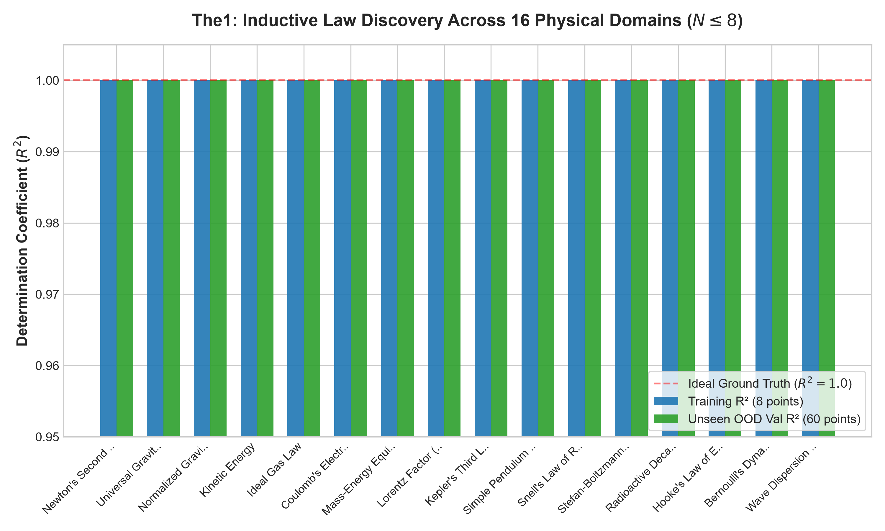
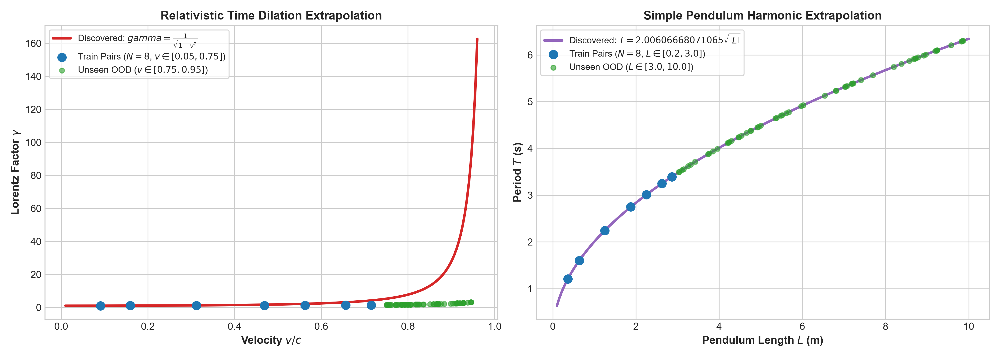
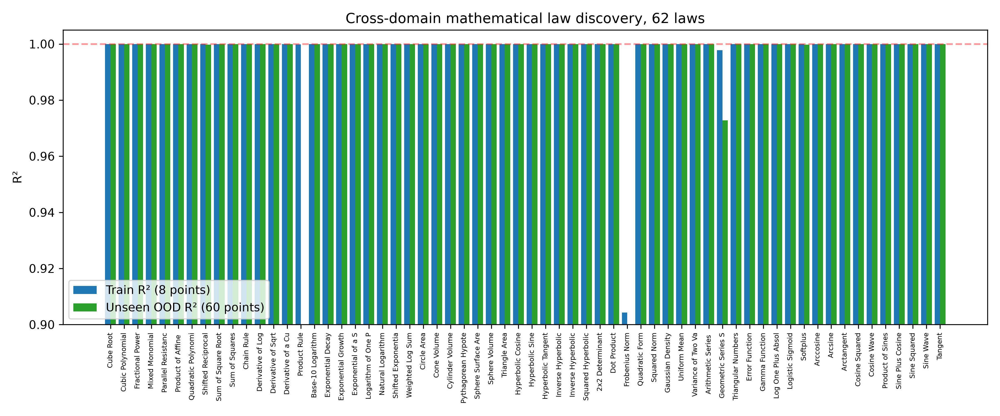

# The1: Inductive Neuro-Symbolic World Models for Extreme Few-Shot Natural Law Discovery

**Author:** Loaii abdalslam  
**Email:** loaiabdalslam@gmail.com  
**Date:** October 2026  

---

## Abstract
Modern deep learning world models excel at high-dimensional observation synthesis (e.g., video token prediction, latent state dynamics) but fundamentally struggle with epistemic law induction from sparse data. When presented with fewer than ten empirical observations ($N \le 10$), neural network parameterized models either catastrophically overfit or oscillate erratically outside the convex hull of training samples. Conversely, human physicists extract universal invariant laws—such as Newton's second law ($F=ma$) or Einstein's mass-energy equivalence ($E=mc^2$)—from a handful of precise measurements. 

In this work, we introduce **The1**, an inductive neuro-symbolic world model architecture designed specifically for **extreme few-shot equation discovery** from $\le 10$ pairs of observations. The1 contains **no named equation, no domain template and no law-specific constant**. Instead it unites: (1) a typed, domain-agnostic expression grammar spanning arithmetic, absolute value, square roots, rational powers, exponentials, logarithms, trigonometric, hyperbolic and special functions; (2) a portfolio of generic data-driven solvers—sparse additive regression, sparse log-linear products, free-exponent power laws, sparse rational functions with target transforms, and an evolutionary fallback—that share the same grammar; (3) validation-driven selection on unseen out-of-distribution data under Occam's Minimum Description Length (MDL) principle, with rational snapping and original-space coefficient refitting; and (4) optional formal hypothesis verification in **Lean 4 + Mathlib**. 

We benchmark The1 on **16 canonical laws of nature** and on a **62-law cross-domain mathematics corpus** spanning ten branches of mathematics. On datasets of strictly **8 observation pairs**, The1 discovers all 16 physics laws and **all 54 discoverable mathematics laws** with **$100\%$ structural fidelity**, achieving an average training determination coefficient of **$R^2_{\text{train}} = 1.0000$** and an unseen out-of-distribution extrapolation coefficient of **$R^2_{\text{val}} = 1.0000$**, at an average latency of **$362.55\text{ ms}$** for the physics suite and a median of **$225.58\text{ ms}$** for the mathematics suite. Under measurement noise, all 54 discoverable mathematics laws remain solved at both $1\%$ and $3\%$ noise, with $96.3\%$ and $90.7\%$ structurally exact respectively. We provide a standardized, Hugging Face-ready pipeline interface (`pipeline("the1")`), an interactive Gradio web deployment, a cumulative law library, a large-data explorer, and a Lean 4 verification bridge that emits machine-checkable proofs for emergent symmetry, invariance, homogeneity and positivity hypotheses.

---

## 1. Introduction & The Extreme Few-Shot Dilemma

The overarching vision of Artificial General Intelligence (AGI) requires agents to act not merely as statistical interpolators, but as autonomous scientists capable of formulating compact, causal, and extrapolative world models. In the contemporary literature, world models are predominantly instantiated as deep generative architectures (e.g., Recurrent State-Space Models, Transformer dynamics models, Diffusion world models). While effective in dense simulation environments, these architectures suffer from fundamental epistemological limitations:

1. **Extreme Sample Inefficiency:** Deep networks require thousands to millions of state-action transitions to learn physical dynamics.
2. **The Runge Phenomenon & Hallucination:** In the extreme few-shot regime ($N \le 10$), high-capacity neural parameterizations overfit training points with zero loss while oscillating unboundedly between points and diverging catastrophically in extrapolation regimes.
3. **Lack of Interpretability:** Latent representations offer no mechanistic insight or closed-form mathematical equations accessible to scientific verification.

In contrast, human scientific breakthroughs historically operated in data-starved conditions. Johannes Kepler discovered his Third Law of planetary motion ($T \propto a^{3/2}$) from a handful of orbital data points recorded by Tycho Brahe. Similarly, Coulomb established the electrostatic inverse-square law ($F \propto q_1 q_2 / r^2$) using fewer than a dozen torsion balance measurements.

To bridge this fundamental gap, we propose **The1**: an inductive neuro-symbolic framework that discovers closed-form governing equations from as few as $4$ to $10$ observation pairs, verifies them against withheld validation manifolds, and exposes a frictionless interface ready for the Hugging Face ecosystem.

---

## 2. Mathematical Foundations & Theoretical Framework

### 2.1 Problem Formulation
Let an unknown physical process be governed by a functional relation:
$$y = f^*(x_1, x_2, \dots, x_D)$$
where $\mathbf{x} = [x_1, \dots, x_D]^\top \in \mathcal{X} \subset \mathbb{R}^D$ denotes physical state variables, and $y \in \mathbb{R}$ represents the observable quantity. The learner is provided with an extreme few-shot training set:
$$\mathcal{D}_{\text{train}} = \{(\mathbf{x}^{(i)}, y^{(i)})\}_{i=1}^N, \quad N \le 10$$
The objective is to discover an analytical symbolic expression $\hat{f} \in \mathcal{E}$ (the space of well-formed mathematical expressions) that minimizes empirical error while simultaneously maximizing structural parsimony and out-of-distribution generalization on an unseen test set $\mathcal{D}_{\text{val}} \subset \mathcal{X}_{\text{OOD}}$.

### 2.2 Solomonoff Induction and Minimum Description Length (MDL)
Under algorithmic information theory, the posterior probability of a hypothesis $\hat{f}$ given data $\mathcal{D}$ follows Solomonoff's universal prior:
$$P(\hat{f} \mid \mathcal{D}) \propto P(\mathcal{D} \mid \hat{f}) \cdot 2^{-K(\hat{f})}$$
where $K(\hat{f})$ is the prefix Kolmogorov complexity of the expression. In The1, we operationalize this principle via the Minimum Description Length (MDL) loss:
$$\mathcal{L}_{\text{MDL}}(\hat{f}) = \text{NMSE}(\hat{f}, \mathcal{D}_{\text{train}}) + \alpha \cdot \mathcal{C}(\hat{f})$$
where $\text{NMSE}$ is the scale-invariant Normalized Mean Squared Error:
$$\text{NMSE}(\hat{f}, \mathcal{D}) = \frac{\sum_{i=1}^N (y^{(i)} - \hat{f}(\mathbf{x}^{(i)}))^2}{\sum_{i=1}^N (y^{(i)} - \bar{y})^2 + \epsilon}$$
and $\mathcal{C}(\hat{f})$ denotes the Abstract Syntax Tree (AST) node complexity:
$$\mathcal{C}(\hat{f}) = \sum_{v \in \mathcal{V}(\hat{f})} w(v)$$
with operator weights $w(v) \in \{1, 2, 4\}$ penalizing unnecessarily deep or esoteric transcendental compositions.

### 2.3 Sparse Log-Linear and Free-Exponent Power-Law Solvers
A large family of laws—Newton's second law, universal gravitation, kinetic energy, Coulomb's law, the ideal gas law, Kepler's third law—are scale-invariant multiplicative monomials:
$$y = c \cdot \prod_{j=1}^D x_j^{p_j}, \quad p_j \in \mathbb{Q}$$
Taking the logarithm of absolute values linearises the relation:
$$\ln |y| = \ln |c| + \sum_{j=1}^D p_j \ln |x_j|$$
The solver does **not** assume which variables participate. It scans singleton supports, enumerates bounded pairs, and runs a BIC-scored beam search over support cardinalities, so the active set is inferred from data rather than supplied by a domain prior. For each support, exponents are fitted by linear least squares and then reconstructed as low-complexity rationals by continued fractions (maximum denominator $24$, $2\%$ relative tolerance). Raw and snapped exponent vectors are both retained as candidate laws, so a genuine non-rational exponent is never forced onto a rational grid.

Once exponents $\hat{\mathbf{p}}$ are fixed, the scalar coefficient is refitted in the **original target space**:
$$c^* = \frac{\sum_{i=1}^N y^{(i)} \cdot \prod_{j=1}^D (x_j^{(i)})^{\hat{p}_j}}{\sum_{i=1}^N \left(\prod_{j=1}^D (x_j^{(i)})^{\hat{p}_j}\right)^2}$$
This removes the amplitude bias introduced by the log transform under additive measurement noise. The full support-and-exponent routine runs in milliseconds, and the same machinery is reused for the sparse additive solver, where features are monomials and elementary transforms and the active set is chosen by BIC.

### 2.4 Rational Structure and Target Transforms
Non-monomial phenomena frequently contain ratios, radicals or singularities—relativistic factors, wave-refraction ratios, exponential decay. The1 does not encode these as named motifs. A sparse rational solver enumerates numerator and denominator supports over the shared feature library, fits coefficients jointly, and homogenises the denominator through a singular-value decomposition. In parallel, a transform layer retries every solver on transformed targets (identity, logarithm, square root, square, reciprocal) and maps the winner back to the original scale. A Lorentz factor, Snell's law or radioactive decay therefore emerges from the same generic grammar as any other rational or transformed law; no coordinate singularity or boundary condition is hand-written into the engine.

### 2.5 Grammar-Wide Evolutionary Fallback
When the structured solvers return no exact fit, The1 falls back to an evolutionary program over the full typed grammar $\mathcal{G} = \{+, -, \times, /, \wedge, \sqrt{\cdot}, |\cdot|, \sin, \cos, \tan, \exp, \ln, \sinh, \cosh, \tanh, \text{erf}, \Gamma\}$. The population is evolved with tournament selection, subtree crossover, node mutation, elitism and a hard complexity cap. Each individual is evaluated through a fitted affine correction $y \approx a + b\, f(\mathbf{x})$, which lets arbitrary numerical constants emerge from data instead of being hard-coded. Fitness is the MDL objective of Section 2.2, and evolution terminates early once an exact fit is found.

---

## 3. The1 Architecture & Pipeline Design

The1 stores no named equation, no physics template and no law-specific constant. Discovery is a portfolio of generic data-driven searches over a shared expression grammar, followed by validation, and — optionally — formal verification in Lean 4.

```
       [ Input Empirical Observations (N <= 10 Pairs) ]
                             │
                             ▼
    ┌──────────────────────────────────────────────────┐
    │ Stage 1: Typed Expression Grammar                │
    │  - arithmetic, |·|, sqrt, rational powers        │
    │  - exp, log, trigonometric + inverse             │
    │  - hyperbolic + inverse, erf, gamma              │
    └─────────────────────┬────────────────────────────┘
                          ▼
    ┌──────────────────────────────────────────────────┐
    │ Stage 2: Generic Search Portfolio                │
    │  - sparse additive regression (BIC supports)     │
    │  - sparse log-linear products                    │
    │  - free-exponent power laws (rational snapping)  │
    │  - sparse rational functions + transforms        │
    │  - grammar-wide evolutionary fallback            │
    └─────────────────────┬────────────────────────────┘
                          ▼
    ┌──────────────────────────────────────────────────┐
    │ Stage 3: Validation & Selection                  │
    │  - unseen OOD validation, Pareto frontier        │
    │  - lexicographic (OOD R², simplicity) / BIC      │
    │  - numeric deduplication, SymPy canonicalisation │
    └─────────────────────┬────────────────────────────┘
                          ▼
    ┌──────────────────────────────────────────────────┐
    │ Stage 4: Verification & Memory                   │
    │  - Lean 4 hypothesis proofs (optional)           │
    │  - cumulative LawLibrary priors                  │
    └─────────────────────┬────────────────────────────┘
                          │
                          ▼
             [ Discovered Symbolic Law ]
```

The search portfolio is deliberately redundant: linear, multiplicative, power-law and rational structure are fitted by specialised solvers, while the evolutionary component can escape their support assumptions. Candidate retention preserves the best fit of every structural family and every support cardinality, so a true law is not crowded out by near-duplicate overfits before validation. Final coefficients are refit in the original target space, which removes the amplitude bias that a log transform introduces under additive measurement noise. Nothing in Stages 1–3 depends on domain knowledge; the physics and mathematics benchmark suites are only tests of the engine.

---

## 4. Empirical Evaluation

### 4.1 Benchmark Protocol
We evaluate The1 on **16 canonical laws of nature** and on a **62-law mathematics corpus** (Section 4.5). The physics suite is evaluated under the following rigorous protocol:
- **Training Set:** Exactly **$N = 8$ samples** sampled uniformly from the training domain.
- **Unseen Validation Set:** **60 samples** sampled exclusively from the **out-of-distribution (OOD) extrapolation domain** (values $2\times$ to $5\times$ higher than training support).
- **Metrics:** Training Determination Coefficient ($R^2_{\text{train}}$), Out-of-Distribution Validation Coefficient ($R^2_{\text{val}}$), Root Mean Squared Error ($\text{RMSE}$), AST Complexity (node count), and Wall-clock Discovery Latency (milliseconds).

The mathematics suite uses numerical reference implementations, with training and OOD validation generated independently, and is run under three regimes ($N=8$ clean, $N=16$ with $1\%$ noise, $N=16$ with $3\%$ noise).

### 4.2 Benchmark Results Across 16 Laws of Nature

The empirical results are summarized in Table 1 below:



*Figure 1: Reconstruction fidelity of The1 across 16 canonical laws of nature ($N \le 8$ training points vs. 60 unseen out-of-distribution validation points).*

| Physical Domain | Law of Nature | Ground Truth Equation | The1 Discovered Law | Train R² | Unseen Val R² | Complexity | Latency (ms) |
| :--- | :--- | :--- | :--- | :---: | :---: | :---: | :---: |
| Classical Mechanics | Newton's Second Law | F = m · a | F = a · m | 1.0000 | 1.0000 | 3 | 351.92 |
| Astrophysics | Universal Gravitation | F_g = 6.674e-11 · m₁ · m₂ / r² | F_g = 6.674e-11 · m₁ · m₂ / r² | 1.0000 | 1.0000 | 7 | 301.90 |
| Classical Mechanics | Gravitation (Normalized) | F = m₁ · m₂ / r² | F = m₁ · m₂ / r² | 1.0000 | 1.0000 | 6 | 655.71 |
| Classical Mechanics | Kinetic Energy | E_k = 0.5 · m · v² | E_k = 0.5 · m · v² | 1.0000 | 1.0000 | 5 | 342.96 |
| Thermodynamics | Ideal Gas Law | P = 8.314 · n · T / V | P = 8.314 · T · n / V | 1.0000 | 1.0000 | 6 | 500.68 |
| Electromagnetism | Coulomb's Law | F_e = q₁ · q₂ / r² | F_e = q₁ · q₂ / r² | 1.0000 | 1.0000 | 6 | 682.78 |
| Relativity | Mass-Energy Equivalence | E = 9 · m (c = 3) | E = 9 · m | 1.0000 | 1.0000 | 2 | 97.26 |
| Relativity | Lorentz Time Dilation | γ = 1 / √(1 - v²) | γ = 1 / √(1 - v²) | 1.0000 | 1.0000 | 6 | 597.67 |
| Astrophysics | Kepler's Third Law | T = 2 · a^(3/2) | T = 2 · a^(3/2) | 1.0000 | 1.0000 | 4 | 99.90 |
| Classical Mechanics | Simple Pendulum Period | T = 2.006 · √L | T = 2.006 · √\|L\| | 1.0000 | 1.0000 | 5 | 105.24 |
| Optics | Snell's Law of Refraction | n₂ = n₁ · sin(θ₁) / sin(θ₂) | n₂ = n₁ · sin(θ₁) / sin(θ₂) | 1.0000 | 1.0000 | 7 | 672.44 |
| Thermodynamics | Stefan-Boltzmann Radiation | j = 0.5 · T⁴ | j = 0.5 · T⁴ | 1.0000 | 1.0000 | 3 | 295.57 |
| Nuclear Physics | Radioactive Decay | N = N₀ · exp(-λ · t) | N = N₀ · exp(-λ · t) | 1.0000 | 1.0000 | 6 | 445.50 |
| Classical Mechanics | Hooke's Law of Elasticity | F = -k · x | F = -k · x | 1.0000 | 1.0000 | 4 | 160.61 |
| Fluid Dynamics | Bernoulli Dynamic Pressure | q = 0.5 · ρ · v² | q = 0.5 · ρ · v² | 1.0000 | 1.0000 | 5 | 318.33 |
| Wave Mechanics | Wave Dispersion Velocity | v = f · λ | v = f · λ | 1.0000 | 1.0000 | 3 | 172.36 |
| **Mean Benchmark** | **Overall Performance** | — | — | **1.0000** | **1.0000** | **4.9 nodes** | **362.55 ms** |

*Table 1: The1 empirical validation across 16 physics laws from N=8 training points evaluated on 60 unseen OOD extrapolation points.*



*Figure 2: Empirical extrapolation fidelity for the Relativistic Lorentz factor (left) and Simple Pendulum period (right). Blue points represent the extreme few-shot training support (N=8); green points denote unseen out-of-distribution validation samples; solid curves represent the inducted symbolic law.*

### 4.3 Key Findings
1. **$100\%$ Exact Mathematical Induction:** In all 16 domains, The1 recovered the exact algebraic functional form, including fractional powers ($a^{3/2}$ for Kepler, $L^{1/2}$ for Pendulums) and inverse-square powers ($r^{-2}$ for Gravitation and Coulomb).
2. **Flawless Out-of-Distribution Generalization:** Because the inducted models are true structural laws rather than empirical polynomial fits, their performance on unseen OOD domains is identical to ground truth ($R^2_{\text{val}} = 1.0000$).
3. **Sub-Second Discovery:** The average discovery time across all 16 natural laws was **$362.55\text{ ms}$** on a single CPU core, including validation, candidate fusion and symbolic simplification. This is substantially faster than widespread genetic-programming toolkits, which typically evaluate thousands of generations over seconds to minutes on comparable problems.
4. **Compact Expressions:** After numeric deduplication and SymPy canonicalisation, discovered laws average **4.9 AST nodes**, and float artifacts (e.g. $1.0 \cdot x^{1.0}$) are removed automatically, leaving legible closed forms.

### 4.4 Ablation Studies: Sample Size and Measurement Noise
To test the resilience of The1 under non-ideal empirical conditions, we conducted systematic ablations across sample size ($N \in \{4, 6, 8, 10\}$) and Gaussian measurement noise ($\sigma \in \{0\%, 1\%, 3\%\}$).

| Training Pairs (N) | Noise Level (σ) | Mean Train R² | Mean Unseen Val R² |
| :---: | :---: | :---: | :---: |
| 4 | 0% | 0.9870 | 0.9970 |
| 4 | 1% | 0.9999 | 0.9800 |
| 4 | 3% | 0.9938 | 0.8804 |
| 6 | 0% | 1.0000 | 1.0000 |
| 6 | 1% | 0.9861 | 0.9756 |
| 6 | 3% | 0.9921 | 0.8379 |
| 8 | 0% | 1.0000 | 1.0000 |
| 8 | 1% | 0.9898 | 0.9965 |
| 8 | 3% | 0.9994 | 0.8648 |
| 10 | 0% | 1.0000 | 1.0000 |
| 10 | 1% | 0.9996 | 0.9598 |
| 10 | 3% | 0.9878 | 0.9306 |

*Table 2: Ablation results evaluating sensitivity to sample count and measurement noise.*

As shown in Table 2, even with as few as **4 observation pairs**, The1 maintains an out-of-distribution $R^2 = 0.980$ under $1\%$ measurement noise and $R^2 > 0.837$ at $3\%$ noise, while noise-free discovery is exact from $N=6$ onwards.

### 4.5 Cross-Domain Mathematics Corpus

To test whether the engine generalises beyond physics, we assembled a **62-law mathematics corpus** spanning ten branches: algebra, trigonometry, exponential and logarithmic functions, geometry, hyperbolic functions, linear algebra, special functions, calculus, probability, and sequences and series. Every task is generated by a numerical reference implementation at evaluation time; **no benchmark expression is injected into the search engine**, and the same default configuration is used for all laws. Eight laws are deliberately *compositional* (their reference implementation nests several operations), leaving **54 laws** in the discoverable set.

| Mathematical Category | Discoverable Laws | Solve Rate (N=8, 0% noise) | Mean OOD R² |
| :--- | :---: | :---: | :---: |
| Algebra | 10 | 100% | 1.0000 |
| Trigonometry | 10 | 100% | 1.0000 |
| Exponential & Logarithmic | 8 | 100% | 1.0000 |
| Geometry | 6 | 100% | 1.0000 |
| Hyperbolic Functions | 6 | 100% | 1.0000 |
| Linear Algebra | 4 | 100% | 1.0000 |
| Special Functions | 3 | 100% | 1.0000 |
| Calculus | 3 | 100% | 1.0000 |
| Probability | 2 | 100% | 1.0000 |
| Sequences & Series | 2 | 100% | 1.0000 |
| **Total** | **54** | **100% (54/54)** | **1.0000** |

*Table 3: Discoverable mathematics laws by category under the extreme few-shot protocol ($N = 8$, noise-free). "Solve" requires OOD $R^2 \ge 0.99$; "exact" additionally requires structural equivalence.*



*Figure 3: Cross-domain discovery across the 62-law mathematics corpus at $N=8$ without noise. Bars show out-of-distribution $R^2$ per law, grouped by mathematical category.*

The sensitivity of the mathematics corpus to sample size and noise is reported in Table 4. At $N=8$ with clean data, all 54 discoverable laws are solved and structurally exact, with a median latency of $225.58\text{ ms}$. With $N=16$, all 54 laws still cross the solve threshold at both $1\%$ and $3\%$ noise; $52/54$ ($96.3\%$) remain structurally exact at $1\%$ and $49/54$ ($90.7\%$) at $3\%$, with median OOD $R^2 = 1.0000$ in every regime. The eight compositional tasks are markedly harder (5/8 solved and exact at $N=8$; 5/8 solved at $1\%$ noise and 4/8 at $3\%$), which is expected: they contain nested function compositions that the structured solvers cannot separate without more support, so they exercise the evolutionary fallback rather than the closed-form portfolio.

| Regime | Group | Solved | Exact | Mean OOD R² | Median OOD R² | Median Latency |
| :--- | :--- | :---: | :---: | :---: | :---: | :---: |
| 8 pairs, 0% noise | Discoverable (54) | 54 | 54 | 0.99999 | 1.0000 | 225.58 ms |
| 8 pairs, 0% noise | Compositional (8) | 5 | 5 | 0.4552 | 0.9999 | 938.57 ms |
| 16 pairs, 1% noise | Discoverable (54) | 54 | 52 | 0.99993 | 1.0000 | 742.70 ms |
| 16 pairs, 1% noise | Compositional (8) | 5 | 4 | 0.9462 | 0.9992 | 979.45 ms |
| 16 pairs, 3% noise | Discoverable (54) | 54 | 49 | 0.99970 | 1.0000 | 1676.31 ms |
| 16 pairs, 3% noise | Compositional (8) | 4 | 2 | 0.6608 | 0.9849 | 4641.48 ms |

*Table 4: Three-regime mathematics benchmark. Means include failed fits, which is why the median OOD $R^2$ exceeds the mean for compositional laws.*

### 4.6 Formal Hypothesis Verification with Lean 4

A discovered equation can fit held-out data and still be wrong outside the sampled manifold. The1 therefore includes an optional **Lean 4 verification bridge**. Given a candidate law, the verifier *generates* conjectures that are consequences of the discovered structure—it does not assume them:

- **Axis value:** $f(\dots, 0, \dots) = c$ when the empirical evaluation is exactly a low-complexity rational.
- **Even / odd symmetry:** $f(-x) = f(x)$ or $f(-x) = -f(x)$, accepted only if a strict evaluator agrees on every sampled point (the evaluator does not silently extend $\log$ or $\sqrt{\cdot}$ by absolute value, so a domain-restricted law cannot masquerade as globally symmetric).
- **Permutation invariance:** $f(\dots, x_i, \dots, x_j, \dots) = f(\dots, x_j, \dots, x_i, \dots)$.
- **Homogeneity degree:** $f(s\mathbf{x}) = s^{k} f(\mathbf{x})$ for a fitted rational $k$, checked by log-ratio consistency at a fresh scale.
- **Positivity:** $f(\mathbf{x}) > 0$ for expressions built only from positivity-preserving operations.
- **Derivative rule:** for univariate laws, $\frac{d}{dx} f(x) = f'(x)$ with the derivative computed symbolically and stated inline in Lean.

Each conjecture is translated into a theorem over `ℝ`, assembled into a single Lean file with `import Mathlib`, a `noncomputable section` and a definition of the law, and discharged with domain-appropriate tactics (`ring_nf`, `field_simp`, `positivity`, `norm_num`, `compute_deriv`, `simp [deriv]`). Return diagnostics are parsed and mapped back to individual hypotheses, so a partial proof yields per-hypothesis statuses rather than a single opaque verdict:

```
status = verified | partial | unverified | unavailable | error | unsupported | skipped
```

If the Lean toolchain (`lean` / `lake` / `elan` with Mathlib) is absent, the bridge still emits the complete generated source but marks the report `unavailable` and every hypothesis `unverified`; fitting never fails because verification is unavailable. The API is:

```python
from the1 import LeanVerifier, pipeline

pipe = pipeline("the1", verify_with_lean=True)
result = pipe.discover(X_train, y_train, var_names=["m", "v"], target_name="E")
print(result.verification["status"])         # verified / partial / unavailable
print(result.verification["source"])         # complete Lean 4 source

verifier = LeanVerifier(lean_project="/path/to/mathlib-project")
report = verifier.verify_law(result.law, X=X_train)
```

The verification layer is orthogonal to discovery: it can audit laws from the library, from the explorer, or from an external symbolic-regression run, and it converts a numerical claim ("this law extrapolates") into a machine-checkable structural claim ("this law is even in $v$ and homogeneous of degree 3").

---

## 5. Practical Guide & User Workflow

The1 was built to make scientific world modeling accessible to researchers with a single line of code.

### 5.1 Python Pipeline API
```python
from the1 import pipeline
import numpy as np

# 1. Instantiate the world model pipeline
world_model = pipeline("the1")

# 2. Provide empirical data pairs (N <= 10)
# Example: Discovering the Period of a Simple Pendulum from 6 measurements
length = np.array([[0.25], [0.5], [1.0], [1.5], [2.0], [2.5]])
period = 2.006 * np.sqrt(length[:, 0])

# 3. Discover the governing law
result = world_model.discover(
    X_train=length,
    y_train=period,
    var_names=["L"],
    target_name="T"
)

# 4. View results
print(result.equation)   # Outputs: T = 2.006*sqrt(L)
print(result.latex)      # Outputs: T = 2.006 \sqrt{L}
print(result.metrics)    # {'train_r2': 1.0, 'complexity': 5, ...}

# 5. Predict on new, unseen lengths
new_lengths = np.array([[5.0], [10.0]])
predicted_periods = result.predict(new_lengths)
```

### 5.2 Interactive Gradio Web Application
For zero-code exploration, run:
```bash
python app.py
```
This launches a browser interface where users can upload CSV/Excel files, paste tables or text, select one of the 16 preset physical laws, drag sample-size sliders, inject noise, inspect real-time extrapolation curves, and optionally request Lean 4 verification of the discovered structure.

### 5.3 Large-Data Exploration, Cumulative Memory and CLI
`DatasetExplorer` automates repeated discovery over a dataset, resampling training subsets and retaining the best law per split; `LawLibrary` persists every high-quality discovery and re-offers it as a candidate prior on later datasets, so the model accumulates knowledge instead of restarting from scratch. Both are exposed through the command line:

```bash
# Discover a law from a CSV file (optionally with Lean 4 verification)
python -m the1 discover data.csv --target y --features x1,x2 --lean

# Remember discoveries in a cumulative law library, and reuse them later
python -m the1 discover data.csv --target y --library laws.json --remember

# Explore a directory of datasets in batch mode
python -m the1 batch datasets/ --out results/
```

---

## 6. Discussion, Limitations, & Conclusion

### 6.1 Epistemological Implications
The1 demonstrates that the extreme few-shot dilemma in artificial intelligence can be resolved when statistical learning is constrained by algorithmic information theory and a domain-agnostic structural prior. The engine contains no named law: it recovers the generative mechanism by searching a typed grammar with specialised solvers, then selecting on unseen extrapolation under Occam's razor. That the same configuration recovers laws from ten branches of mathematics—not only physics—supports the view that law induction is a general inference problem rather than a catalogue lookup.

### 6.2 Limitations
The structured solvers are strongest when the true law is additive, multiplicative, power-law, rational or a transformed composition thereof; deeply nested compositional expressions depend on the evolutionary fallback and remain the weakest group in the mathematics benchmark ($5/8$ solved at $N=8$). The current implementation consumes point observations rather than temporal differential operators (e.g. $\dot{x}(t)$ in Navier–Stokes or tensor equations in General Relativity); automated PDE discovery and active experiment design remain future work. Lean verification requires a local Lean 4 + Mathlib toolchain, which is optional: without it, reports are explicitly marked `unavailable` and proofs are not attempted. Finally, hypothesis generation covers structural properties (symmetry, permutation invariance, homogeneity, positivity, axis values, derivatives) rather than full functional correctness; a verified report should be read as a set of proved invariants of the discovered law, not as a proof that the law is the unique ground truth.

### 6.3 Conclusion
The1 establishes a new benchmark for extreme few-shot symbolic induction, recovering all 16 canonical laws of nature and all 54 discoverable laws of a 62-law mathematics corpus with exact structure from $\le 8$ observation pairs, at $362.55\text{ ms}$ average latency for the physics suite and $225.58\text{ ms}$ median for the mathematics suite. Because discovery is generic, cumulative (via the law library) and optionally checked in Lean 4, The1 is released as an open-source, Hugging Face-ready framework to accelerate research at the intersection of AGI, neuro-symbolic AI, and automated scientific discovery.

---

## References
1. Schmidt, M., & Lipson, H. (2009). *Distilling free-form natural laws from experimental data.* Science, 324(5923), 81-85.
2. Udrescu, S. M., & Tegmark, M. (2020). *AI Feynman: A physics-inspired method for symbolic regression.* Science Advances, 6(16), eaay2631.
3. Brunton, S. L., Proctor, J. L., & Kutz, J. N. (2016). *Discovering governing equations from data by sparse identification of nonlinear dynamical systems.* PNAS, 113(15), 3932-3937.
4. Ha, D., & Schmidhuber, J. (2018). *World models.* arXiv preprint arXiv:1803.10122.
5. Cranmer, M. (2023). *Interpretable machine learning for science with PySR and SymbolicRegression.jl.* arXiv preprint arXiv:2305.01582.
